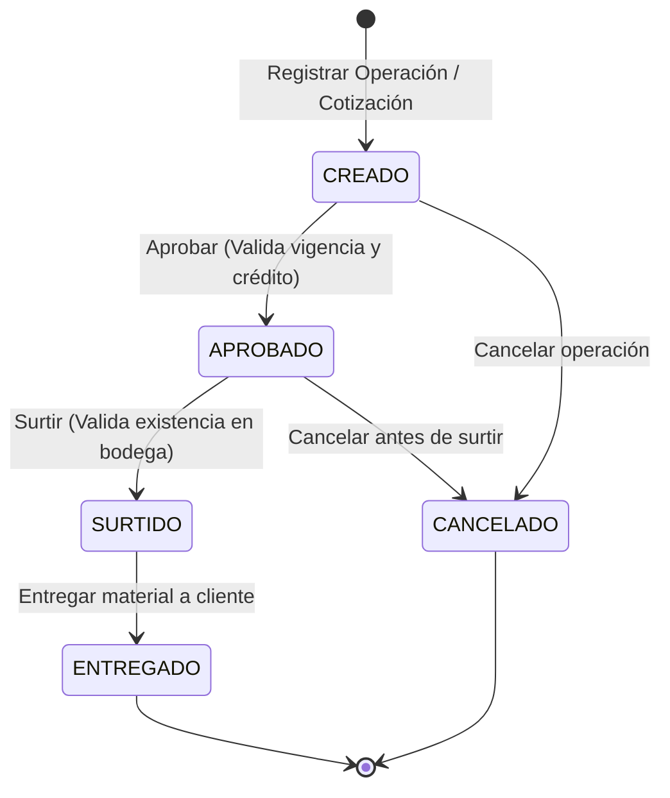

# Documento de Requerimientos de Negocio (BRD) — FerreMax S.A. de C.V.

**Proyecto Final: Componentes de Lógica de Negocio (PIA)**  
**Facultad de Ingeniería Mecánica y Eléctrica (FIME - UANL)**  
**Empresa Asignada:** FerreMax (Giro ferretero, materiales de construcción y aceros).

---

## 1. Información General y Alcance del Sistema
FerreMax es una empresa comercializadora de artículos ferreteros, aceros y materiales para la construcción. Este sistema materializa la propuesta arquitectural del proceso central de la empresa: **cotización, crédito, venta, control de inventario y despacho/entrega**, aplicando Domain-Driven Design (DDD), Specification Pattern y State Machine.

---

## 2. Glosario de Dominio (Ubiquitous Language)
- **Actor / Comprador:** Persona física o moral que adquiere insumos. Puede tener clasificación preferente (VIP) o estándar.
- **Recurso / Artículo:** Bien físico inventariable (taladros, varillas, cemento, tornillería) con precio unitario en MXN, stock y estado habilitado.
- **Operación:** Transacción comercial que inicia en estado `CREADO` y avanza mediante una máquina de estados.
- **Detalle de Operación:** Líneas de artículos que componen la operación con cantidad y subtotal.
- **Cotización:** Documento con vigencia temporal que congela precios y condiciones de entrega para clientes.
- **Línea de Crédito:** Límite financiero pre-aprobado para personas morales y contratistas.
- **Inventario / Existencia:** Cantidad física en bodega menos la cantidad comprometida para órdenes en curso.
- **Entrega Parcial:** Procedimiento operativo cuando el inventario no cubre la demanda total y se despacha lo disponible.
- **Domain Event:** Hecho inmutable que ocurrió en el dominio (ej. `OperacionAprobadaEvent`).

---

## 3. Matriz de 15 User Stories con Criterios de Aceptación en Gherkin

### US-01: Venta Rápida en Mostrador (CU-01)
**Como** cajero de mostrador  
**Quiero** procesar la venta de artículos ferreteros de entrega inmediata  
**Para** atender ágilmente a los clientes en sucursal.
```gherkin
Escenario: Venta de mostrador con inventario suficiente
  Dado que el artículo "CEM-001" tiene 60 bultos en existencia y 5 comprometidos
  Cuando el cajero procesa una venta de 10 bultos
  Entonces el sistema confirma la venta, descuenta 10 bultos de la existencia y emite el ticket con folio.
```

### US-02: Rechazo de Venta por Inventario Insuficiente
**Como** cajero de mostrador  
**Quiero** que el sistema impida ventas que sobrepasen el stock disponible  
**Para** evitar faltantes físicos al cliente.
```gherkin
Escenario: Intento de venta que excede el disponible
  Dado que el artículo "TAL-650" tiene 8 piezas en stock y 0 comprometidas
  Cuando el cajero intenta cobrar 12 piezas
  Entonces el sistema rechaza la operación con error "Inventario insuficiente" y no altera el inventario.
```

### US-03: Validación de Vigencia de Cotización (CU-03)
**Como** ejecutivo de ventas  
**Quiero** validar la vigencia de una cotización empresarial  
**Para** asegurar que los precios pactados sigan siendo válidos.
```gherkin
Escenario: Operación detenida por cotización vencida
  Dado una cotización con vigencia caducada
  Cuando se intenta procesar una orden a partir de dicha cotización
  Entonces el sistema detiene la transacción y exige renovar la cotización.
```

### US-04: Validación de Línea de Crédito
**Como** analista de crédito y cobranza  
**Quiero** verificar la autorización de crédito del cliente  
**Para** mitigar el riesgo de cartera vencida.
```gherkin
Escenario: Despacho a crédito no autorizado
  Dado un cliente con crédito bloqueado por mora
  Cuando se intenta autorizar el despacho a crédito
  Entonces el sistema rechaza la operación solicitando pago de contado.
```

### US-05: Surtido Parcial por Faltante de Almacén (CU-04)
**Como** bodeguero  
**Quiero** marcar un pedido como Parcial cuando no hay material suficiente  
**Para** entregar lo disponible y solicitar transferencia de sucursal.
```gherkin
Escenario: Pedido marcado como parcial
  Dado un pedido de 100 bultos de cal pero solo hay 55 en bodega
  Cuando se gestiona el surtido del pedido
  Entonces el estado del pedido cambia a "Parcial" y se notifica la solicitud de resurtido.
```

### US-06: Evaluación de Regla 'puede_procesarse' (Specification)
**Como** motor de lógica de negocios  
**Quiero** validar que el cliente esté activo, el detalle no esté vacío y la orden cuente con autorización  
**Para** permitir el procesamiento de la operación.
```gherkin
Escenario: Operación válida para procesarse
  Dado un comprador activo con ID "FER-C001"
  Y una operación con al menos 1 línea de detalle
  Y la orden marcada como autorizada
  Cuando se evalúa la regla PuedeProcesarseSpecification
  Entonces el resultado es CUMPLE.
```

### US-07: Rechazo de Operación de Cliente Inactivo
**Como** sistema de control  
**Quiero** bloquear órdenes de clientes suspendidos  
**Para** cumplir con políticas comerciales.
```gherkin
Escenario: Bloqueo de cliente inactivo
  Dado un comprador inactivo
  Cuando se evalúa PuedeProcesarseSpecification
  Entonces la especificación retorna Falso (NO_CUMPLE).
```

### US-08: Beneficio de Descuento / Preferencia VIP (Specification)
**Como** comprador preferente (VIP)  
**Quiero** recibir condiciones preferenciales en órdenes grandes  
**Para** premiar mi lealtad comercial.
```gherkin
Escenario: Aplica beneficio VIP
  Dado un cliente preferente (es_preferente = 1)
  Y una orden con importe total mayor o igual a $1,500 MXN
  Y sin promoción activa
  Cuando se evalúa BeneficioReferenciaSpecification
  Entonces el resultado es APLICA.
```

### US-09: Exclusión de Beneficio VIP por Promoción Activa
**Como** departamento de finanzas  
**Quiero** que el beneficio VIP no se acumule con promociones existentes  
**Para** no comprometer el margen de utilidad.
```gherkin
Escenario: No acumulación de promociones
  Dado un cliente preferente con compra de $3,000 MXN pero con promocion_activa = 1
  Cuando se evalúa BeneficioReferenciaSpecification
  Entonces el resultado es NO_APLICA por la negación lógica NOT PromocionActiva.
```

### US-10: Aprobación en Máquina de Estados (State Machine)
**Como** supervisor de ventas  
**Quiero** autorizar una operación en estado CREADO  
**Para** que avance a la fase de surtido en bodega.
```gherkin
Escenario: Transición legal de CREADO a APROBADO
  Dado una operación en estado CREADO
  Cuando el supervisor ejecuta la acción aprobar
  Entonces el estado cambia a APROBADO y se emite el evento OperacionAprobadaEvent.
```

### US-11: Surtido de Material en Almacén
**Como** jefe de almacén  
**Quiero** surtir los artículos de una orden aprobada  
**Para** preparar el embarque de entrega.
```gherkin
Escenario: Transición legal de APROBADO a SURTIDO
  Dado una operación en estado APROBADO
  Cuando el almacén ejecuta la acción surtir
  Entonces el estado cambia a SURTIDO y se registra OperacionSurtidaEvent.
```

### US-12: Entrega Final de Material
**Como** chofer de reparto o entregador de mostrador  
**Quiero** registrar la entrega física del material al cliente  
**Para** concluir el ciclo de vida de la orden.
```gherkin
Escenario: Transición legal de SURTIDO a ENTREGADO
  Dado una operación en estado SURTIDO
  Cuando se ejecuta la acción entregar
  Entonces el estado final es ENTREGADO y se cierra el ciclo de la orden.
```

### US-13: Cancelación de Operación
**Como** ejecutivo comercial  
**Quiero** cancelar una orden que aún no ha sido surtida  
**Para** liberar material comprometido ante desistimiento del comprador.
```gherkin
Escenario: Cancelación legal desde CREADO
  Dado una operación en estado CREADO
  Cuando se ejecuta la acción cancelar con motivo "Cliente canceló proyecto"
  Entonces el estado cambia a CANCELADO y se emite OperacionCanceladaEvent.
```

### US-14: Protección contra Salto Ilegal de Estados
**Como** auditor del sistema  
**Quiero** que se rechacen transiciones fuera de orden  
**Para** evitar inconsistencias operativas.
```gherkin
Escenario: Intento de saltar de CREADO a ENTREGADO
  Dado una operación en estado CREADO
  Cuando se intenta ejecutar la acción entregar directamente
  Entonces el sistema lanza TransicionEstadoInvalidaException y mantiene el estado CREADO.
```

### US-15: Emisión de Ticket Comercial
**Como** cliente de mostrador  
**Quiero** recibir un comprobante impreso con desglose e IVA  
**Para** respaldo de mi compra y control fiscal.
```gherkin
Escenario: Emisión exitosa de comprobante
  Dado una venta confirmada con folio "VTA-1002"
  Cuando se concluye el cobro
  Entonces el sistema genera el ticket imprimible con fecha, cajero, desglose y total.
```

---

## 4. Diagrama de Procesos (BPMN)


